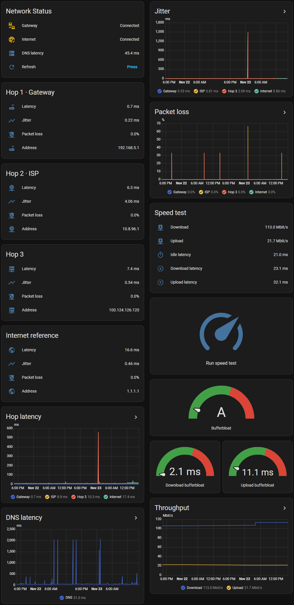

# Internet Health Monitor

See where your internet slows down, from Home Assistant. Internet Health Monitor measures latency, jitter and packet loss to your router, the next two routers past it and an address past your ISP, so you can tell whether a problem starts at home, on your line or beyond. Works with any ISP.

## Features

- Latency, jitter and packet loss every 60 seconds for your gateway, your ISP's first router and the one after it
- The same three readings for an internet reference past your ISP: Cloudflare's 1.1.1.1 by default, another provider, or off
- DNS lookup time at your own DNS server, or one you pick
- Gateway reachable and internet reachable sensors for automations
- Optional speed tests with Cloudflare, M-Lab or LibreSpeed, from a button or overnight, spaced to fit a data budget, each graded for bufferbloat on Waveform's A+ to F scale
- A dashboard card you add and set up from the dashboard, without YAML
- The gateway, hops and DNS server are found without setup

## Dashboard

[More screenshots on GitHub](https://github.com/solentlabs/internet_health_monitor#dashboard-card)

## Setup

Requires Home Assistant 2026.10 or later on Linux (HA OS, Container, Supervised or Core).

1. Open **Settings → Marketplace**, search for Internet Health Monitor and install it. If the search finds nothing, add `https://github.com/solentlabs/internet_health_monitor` as a custom repository (type Integration) first. On Home Assistant before 2026.11, use HACS the same way.
2. Restart Home Assistant.
3. Settings → Devices & Services → Add Integration → "Internet Health Monitor". Every setting has a default; gateway, hops and DNS server are found on their own.

## Privacy and security

Pings and traceroutes go to your router, your ISP's next two routers and the internet reference: Cloudflare's 1.1.1.1 unless you pick another provider or turn it off. DNS lookups go to your own DNS server, or to a public one if you choose it. The rest is off until you turn it on: a speed test service (M-Lab publishes your IP address with every result, and asks you first), and hop ownership, which sends your ISP's router addresses, never your own, to Team Cymru. GitHub CodeQL scans every push to main, every pull request and weekly.

## Using the integration

- [Full documentation](https://github.com/solentlabs/internet_health_monitor#readme): every setting, sensor and attribute
- [Speed tests and data use](https://github.com/solentlabs/internet_health_monitor#speed-testing): the services compared, and how much data a test uses
- [Troubleshooting](https://github.com/solentlabs/internet_health_monitor#troubleshooting): missing hops, missing tools, reporting a problem
- [Changelog](https://github.com/solentlabs/internet_health_monitor/blob/main/CHANGELOG.md): what changed in each release

## Support

Bugs go to [GitHub Issues](https://github.com/solentlabs/internet_health_monitor/issues), with the diagnostics download; questions and ideas to [GitHub Discussions](https://github.com/solentlabs/internet_health_monitor/discussions).

## License

MIT. The project's names and logos are not covered by it; see [TRADEMARKS.md](https://github.com/solentlabs/internet_health_monitor/blob/main/TRADEMARKS.md).
